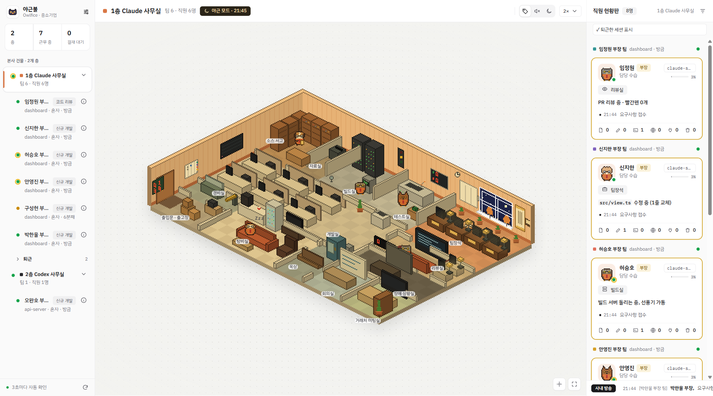
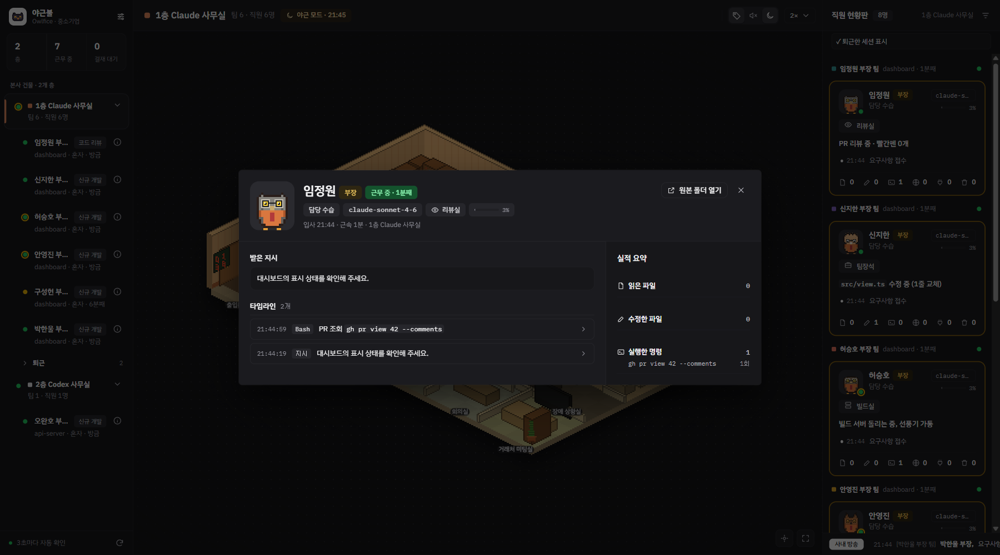

  

<h1 align="center">Owlfice · 야근불</h1>

<strong>AI는 일하고, 사무실은 살아납니다.</strong>

  <a href="https://github.com/dbwk10317/owlfice/raw/refs/heads/main/release/Owlfice_0.1.0_x64-setup.exe">Windows 설치 파일 다운로드</a>
  · <a href="release/">설치 파일 목록</a>

내 컴퓨터에서 일하는 AI 코딩 에이전트를 작은 픽셀아트 사무실로 보여주는 Windows 앱입니다. 세션은 팀이 되고, 에이전트는 올빼미 직원이 됩니다. 읽기·테스트·코드 수정이 직원의 행동으로 나타납니다. AI가 일하는 동안 가끔 들여다보세요.

*실제 UI에 합성 데이터를 넣은 예시입니다.*

## 사무실에서 볼 수 있는 것

- **움직이는 올빼미 직원** — 파일 읽기, 코드 수정, 테스트 같은 작업을 사무실 안 움직임으로 보여줍니다.
- **팀별 현황** — 여러 세션과 서브에이전트가 지금 무엇을 하는지 한눈에 살펴봅니다.
- **직원 업무 기록** — 직원을 누르면 받은 지시, 사용 모델, 최근 작업을 확인합니다.
- **나만의 회사** — 회사 규모와 이름, 사장님 이름을 정합니다.
- **결재 알림** — 창이 보이지 않을 때 결재 대기가 길어지면 Windows 알림으로 알려줍니다.
- **세션 자동 탐색** — 세션 폴더를 찾아 읽고, 다른 위치는 설정에서 직접 추가합니다.

*실제 UI에 합성 데이터를 넣은 예시입니다.*

## 지원 환경

| 구분 | 지원 범위 |
| --- | --- |
| 실행 환경 | Windows x64 |
| Claude | Claude Code CLI, Claude 데스크톱 앱의 Code 탭 |
| Codex | Codex CLI, Codex 앱 |
| 세션 위치 | Windows와 실행 중인 WSL 배포판 |

실행 중인 WSL 배포판의 세션도 함께 보여 줍니다. 화면에 표시되는 정보는 각 도구가 세션 파일에 남긴 기록에 따라 달라집니다.

## 시작하기

1. 위의 **Windows 설치 파일**을 내려받아 설치하고 야근불을 엽니다.
2. 첫 화면에서 **회사 규모**를 고릅니다. 여러 팀을 한 사무실에 모으거나 팀마다 사무실을 나눌 수 있습니다.
3. **Claude Code 또는 Codex로 작업을 시작**합니다. 세션을 찾으면 직원이 출근합니다. 보이지 않는다면 설정에서 세션 경로를 추가하고 **지금 다시 찾기**를 눌러 보세요.

## 내 컴퓨터 안에서, 읽기 전용으로

야근불은 세션 기록을 읽어 화면에 보여줍니다. 에이전트에 명령을 보내거나 세션 파일을 수정하지 않으며, 세션 내용을 외부 서버로 전송하지 않습니다. 설정과 직원 이름, 진단 로그는 내 컴퓨터에 저장합니다.

기록만으로 확정할 수 없는 상태는 **추정**으로 구분합니다. 화면의 연출이 에이전트의 모든 내부 상태를 뜻하지는 않습니다.

## 개발하기

소스에서 실행하거나 빌드하려면 [빌드·테스트 안내](docs/BUILD.md)를 참고하세요. 수집과 상태 판정의 기준은 [동작 계약](docs/CONTRACTS.md), 화면 규격은 [디자인 가이드](design/HANDOFF.md)에 정리돼 있습니다.

## 라이선스

이 프로젝트는 [MIT 라이선스](LICENSE)를 따릅니다.

포함된 글꼴은 SIL Open Font License 1.1을 따릅니다.

- [IBM Plex Sans KR · IBM Plex Mono](design/fonts/LICENSE-IBM-Plex.txt)
- [Galmuri](design/fonts/LICENSE-Galmuri.txt)
